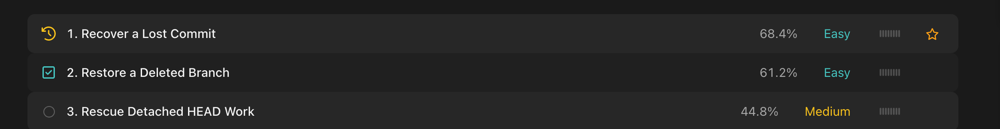
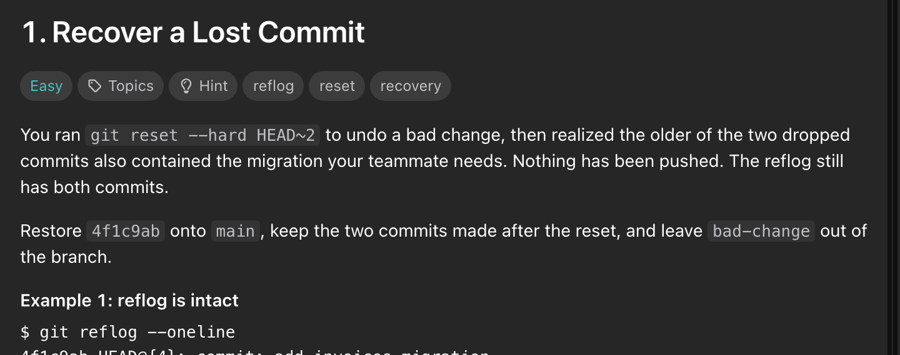

<p align="center">
  
</p>

<h1 align="center">GitCode</h1>

<p align="center">
  <strong>LeetCode for Git.</strong><br>
  Recover lost commits, untangle merges, rebase shared branches, bisect regressions.<br>
  A static, pixel-faithful re-creation of LeetCode's problem set and question pages — with a Git curriculum.
</p>

<p align="center">
  <a href="https://abhinav-prabhakar.github.io/gitcode/"></a>
  
  
</p>

<p align="center">
  <a href="https://abhinav-prabhakar.github.io/gitcode/">abhinav-prabhakar.github.io/gitcode</a>
</p>

---

## Screens

<table>
  <tr>
    <td width="50%"><a href="https://abhinav-prabhakar.github.io/gitcode/"></a></td>
    <td width="50%"></td>
  </tr>
  <tr>
    <td align="center"><sub><b>Dashboard</b> · light · 1440 px</sub></td>
    <td align="center"><sub><b>Question</b> · dark · 1440 px</sub></td>
  </tr>
</table>


<p align="center"><sub><b>Question</b> · light · 1440 px</sub></p>

---

## Anatomy


<p align="center"><sub>Keyword tags, inverted category pills, scroll arrow</sub></p>



<p align="center"><sub>44 px rows · zebra striping · acceptance · difficulty · premium meter · hover bookmark</sub></p>

<table>
  <tr>
    <td width="30%" valign="top"></td>
    <td width="70%" valign="top">
      
      
    </td>
  </tr>
  <tr>
    <td align="center"><sub>270 px rail · calendar · daily · trending</sub></td>
    <td align="center"><sub>36 px tab strip · 28 px tabs · 24/32 title</sub></td>
  </tr>
</table>


<p align="center"><sub>Interactive-looking terminal · prompt, hashes, and shell colours</sub></p>


<p align="center"><sub>Workspace panel · HEAD, upstream, conflicts, stashes, files</sub></p>

---

## Every width

<table>
  <tr>
    <td width="50%" align="center"></td>
    <td width="50%" align="center"></td>
  </tr>
  <tr>
    <td align="center"><sub><b>Dashboard</b> · 390 px</sub></td>
    <td align="center"><sub><b>Question</b> · 390 px</sub></td>
  </tr>
</table>

<p align="center"><sub>Verified at 320 / 480 / 768 / 1024 / 1440 px · zero horizontal overflow · zero console errors</sub></p>

---

## Run it

```bash
python3 -m http.server 8000
```

Open <http://127.0.0.1:8000> — or use the **[live demo](https://abhinav-prabhakar.github.io/gitcode/)**.
The pages also work from `file://`; the scripts are classic `<script>` tags, not ES modules.

---

## How it's built

- **Two static pages.** `index.html` is the problem set; `problem.html?p=<slug>` is the question.
- **LeetCode's own CSS.** The compiled stylesheets in `assets/css/vendor/` are vendored untouched,
  and copied components keep their original class names. Only pieces LeetCode has no
  equivalent for are authored as `gc-*` in `assets/css/app.css`.
- **No framework, no build.** Vanilla JS, local data, TypoRound vendored for offline rendering.
- **Deterministic demo.** 44 Git tasks, 7 categories, 6 tracks. Run/Submit renders simulated
  results; nothing leaves the browser.

The full design contract — palette, dimensions, component anatomy, responsive rules — lives in
**[`design.md`](./design.md)**.

<details>
<summary><b>File map</b></summary>

```
index.html                  dashboard shell
problem.html                question-page shell
design.md                   design-system contract

assets/
  css/vendor/               LeetCode CSS, byte-for-byte (do not edit)
  css/app.css               tokens + authored gc-* components
  fonts/                    TypoRound (rounded Premium/promo face)
  js/icons.js               icon geometry + icon()
  js/data.js                44 tasks, categories, tracks, daily/trending
  js/ui.js                  nav, theme, menus, modals, tabs, splitters
  js/dashboard.js           filtering, search, bookmarks, rail
  js/problem.js             statement, panels, terminal, run/submit

docs/screenshots/           every image above
_reference/                 capture manifest + collector
```

</details>

<details>
<summary><b>What is intentionally not wired</b></summary>

No backend, no authentication, no real Git execution, no network calls. Theme and bookmarks
persist in `localStorage`; everything else resets on reload. Solutions, submissions, and the
editorial are representative static content.

</details>

---

<p align="center">
  <sub>Git-themed content on a faithful LeetCode shell. Not affiliated with LeetCode.</sub>
</p>
