<p align="center">
  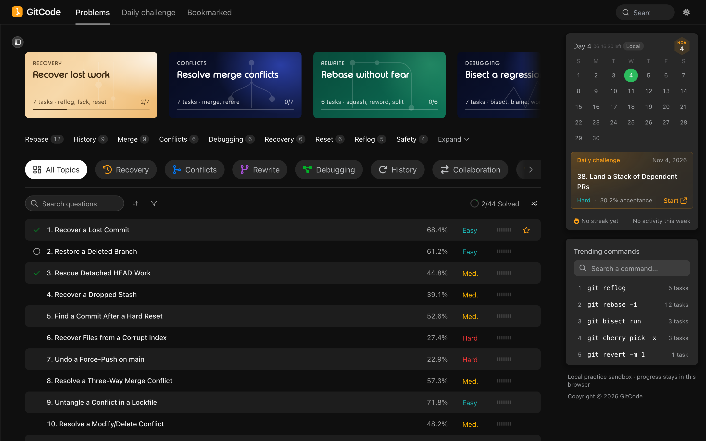
</p>

<h1 align="center">GitCode</h1>

<p align="center">
  <strong>LeetCode for Git.</strong><br>
  Recover lost commits, untangle merges, rebase shared branches, bisect regressions.<br>
  A pixel-faithful LeetCode shell wrapped around 44 Git tasks you can actually solve in the browser.
</p>

<p align="center">
  <a href="https://abhinav-prabhakar.github.io/GitCode/"></a>
  
  
  <a href="https://github.com/Abhinav-Prabhakar/GitCode/actions/workflows/labs.yml"></a>
</p>

<p align="center">
  <a href="https://abhinav-prabhakar.github.io/GitCode/">abhinav-prabhakar.github.io/GitCode</a>
</p>

---

## Screens

<table>
  <tr>
    <td width="50%"><a href="https://abhinav-prabhakar.github.io/GitCode/">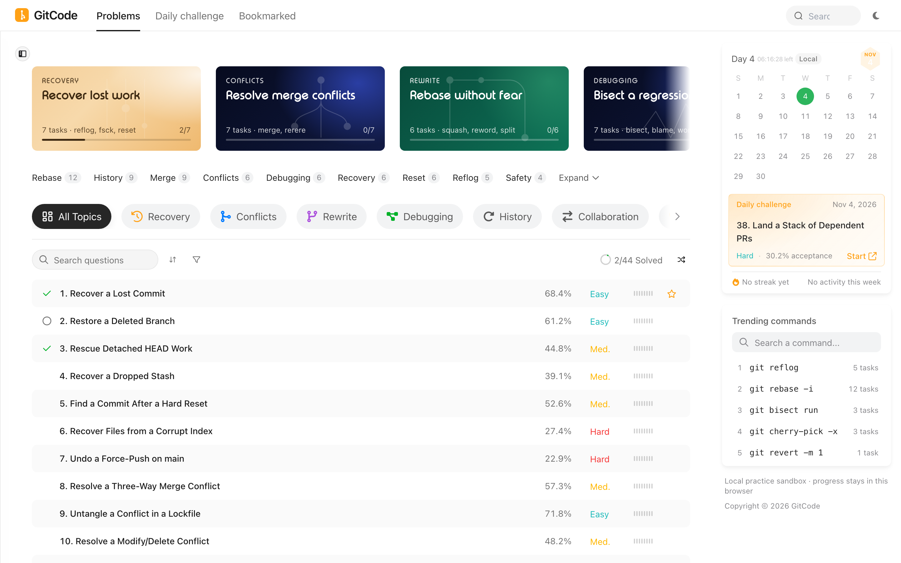</a></td>
    <td width="50%">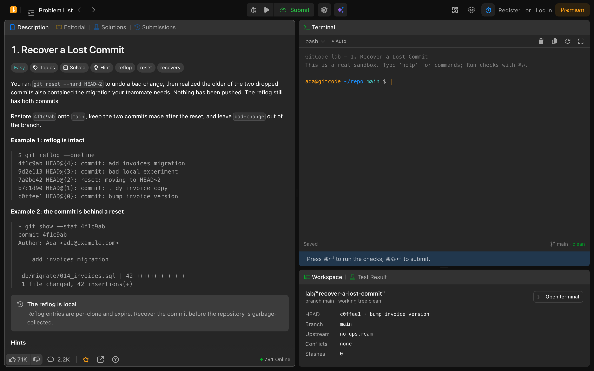</td>
  </tr>
  <tr>
    <td align="center"><sub><b>Dashboard</b> · light · 1440 px</sub></td>
    <td align="center"><sub><b>Question</b> · dark · 1440 px</sub></td>
  </tr>
</table>

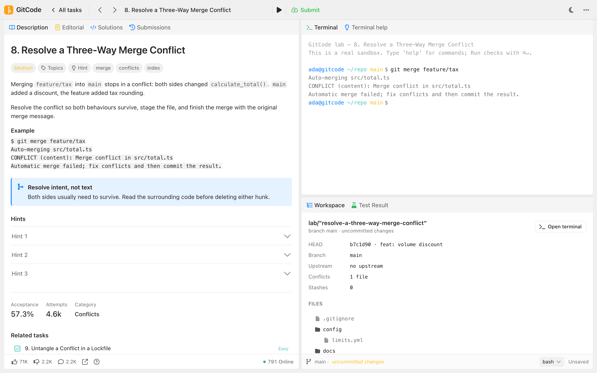

<p align="center"><sub><b>Question</b> · light · 1440 px</sub></p>

---

## Every task is a real sandbox

Each task seeds its own deterministic repository. The terminal is a working Git engine — commits,
trees, refs, reflog, merge, rebase, cherry-pick, stash, bisect, filter-repo — and Run / Submit inspect
the live index and refs. Nothing is prerecorded.

**Run** shows the visible outcome checks and never reveals the hidden one. **Submit** runs the full
set, including the hidden objective check, and records the result. Because this is a static site, the
check code ships to the browser: hidden means withheld from the UI, not cryptographically secret.

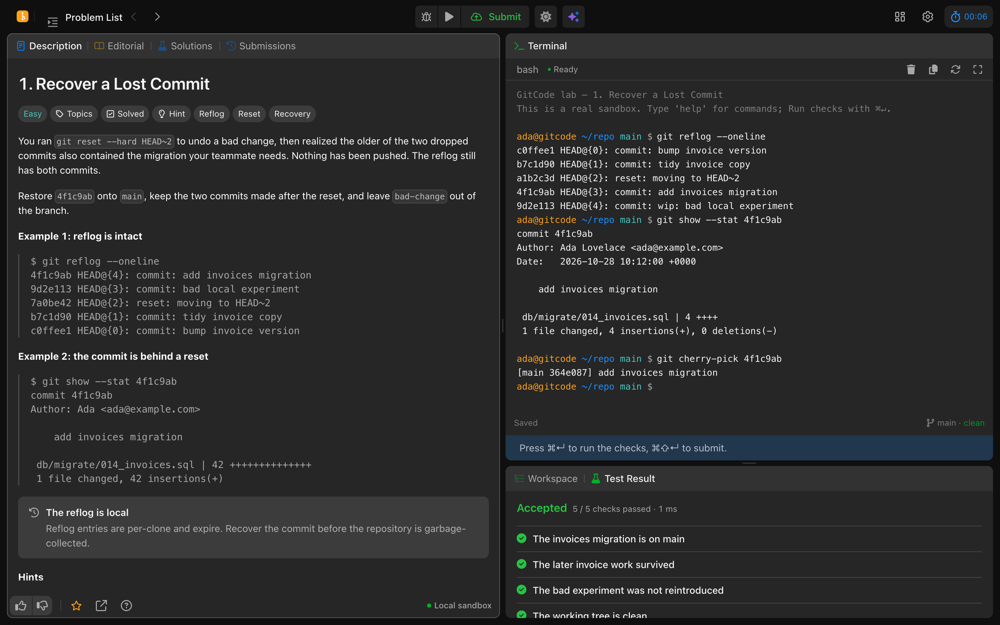

<p align="center"><sub><b>Run</b> · visible checks read the live repository · Submit adds the hidden objective check</sub></p>

<table>
  <tr>
    <td width="50%">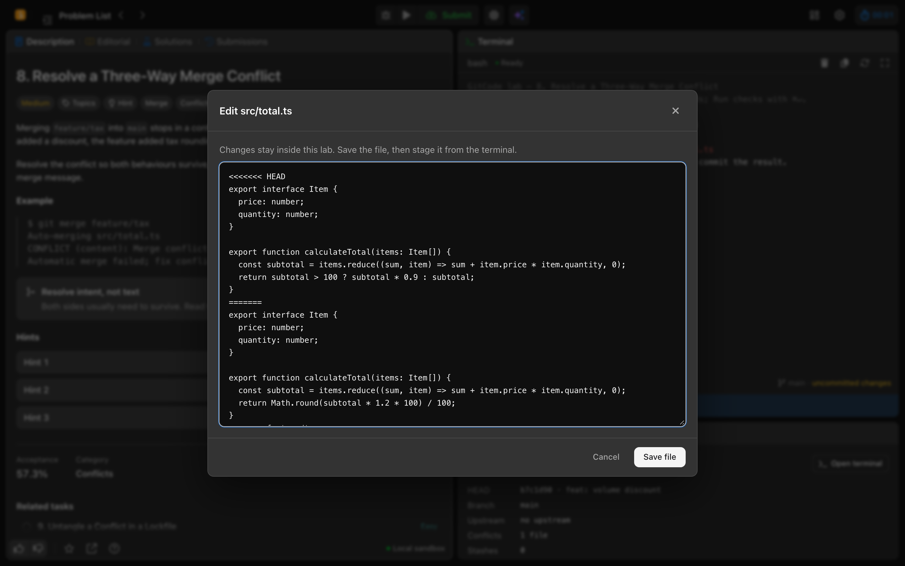</td>
    <td width="50%">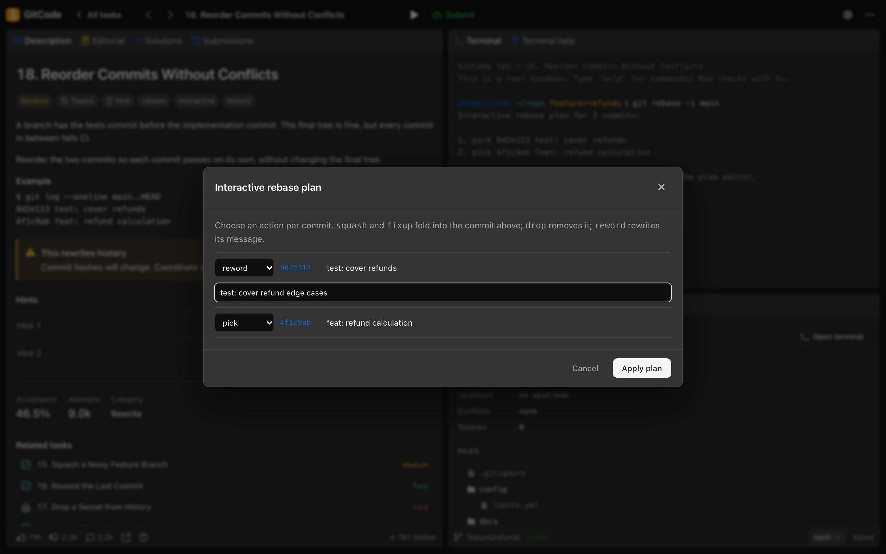</td>
  </tr>
  <tr>
    <td align="center"><sub><b>edit &lt;path&gt;</b> · resolve conflicts in place · save, then stage</sub></td>
    <td align="center"><sub><b>git rebase -i</b> · pick · squash · fixup · reword · drop</sub></td>
  </tr>
</table>

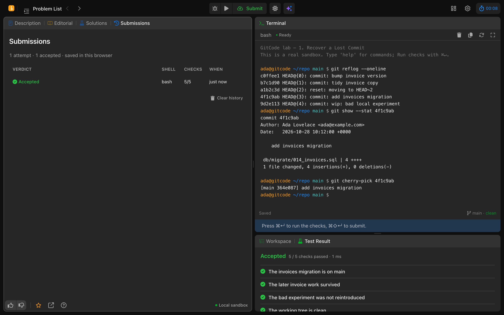

<p align="center"><sub><b>Submissions</b> · accepted and failed attempts · stored locally · replay any result</sub></p>

<table>
  <tr>
    <td width="50%">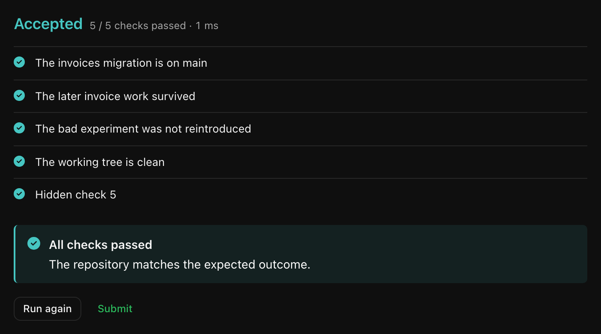</td>
    <td width="50%">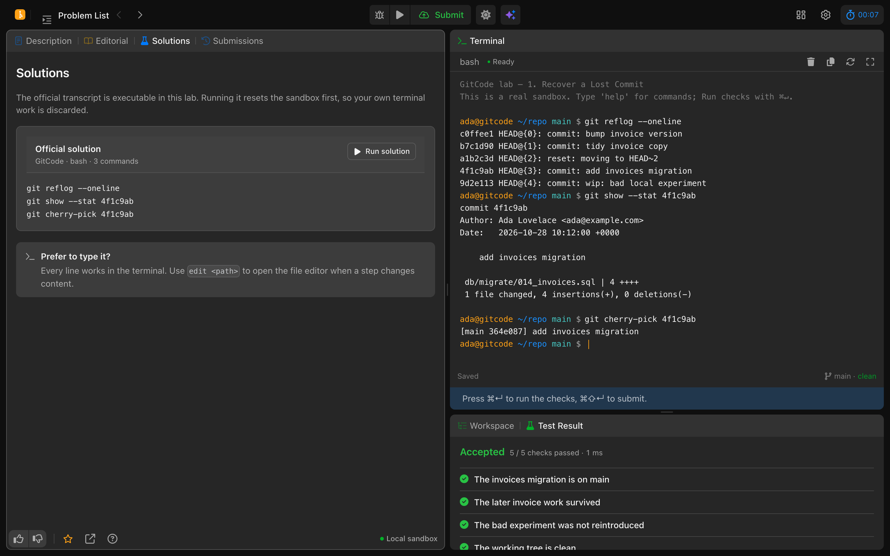</td>
  </tr>
  <tr>
    <td align="center"><sub><b>Checks</b> · Run shows visible checks · Submit adds the hidden one</sub></td>
    <td align="center"><sub><b>Solutions</b> · the official transcript runs end to end</sub></td>
  </tr>
</table>

---

## Anatomy

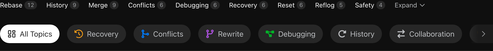

<p align="center"><sub>Keyword tags, inverted category pills, scroll arrow</sub></p>

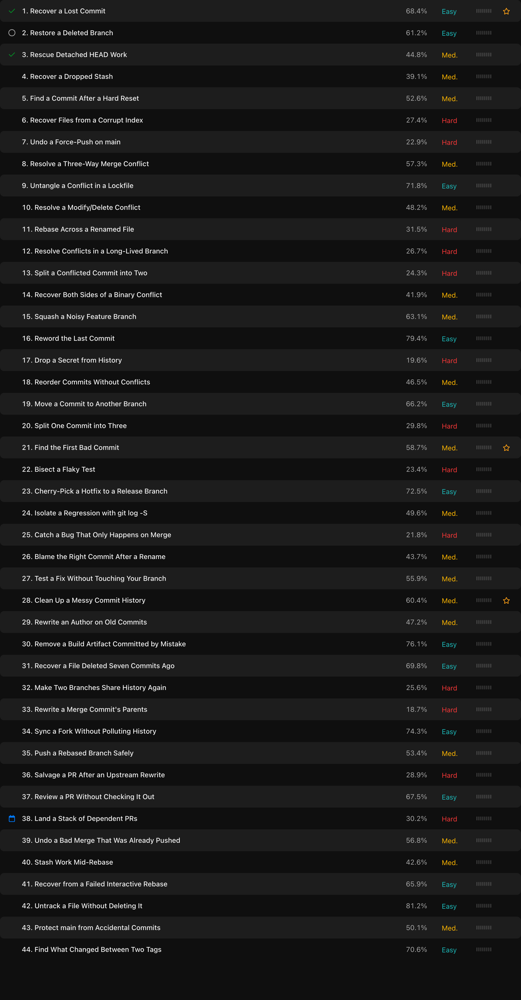

<p align="center"><sub>44 px rows · zebra striping · solved check · aligned acceptance and <code>Med.</code> · hover bookmark</sub></p>

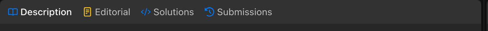

<p align="center"><sub>36 px tab strip · 28 px tabs · icon colours per panel</sub></p>

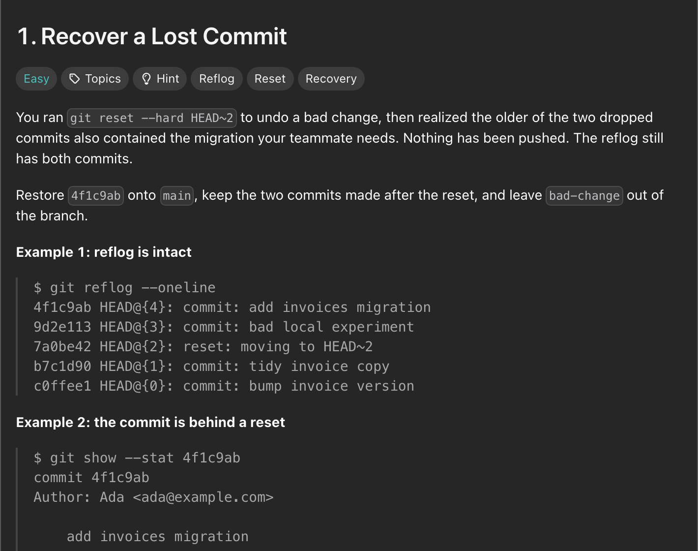

<p align="center"><sub>24/32 title · difficulty + topic chips · 14/21 prose · inline code</sub></p>

<table>
  <tr>
    <td width="32%" valign="top">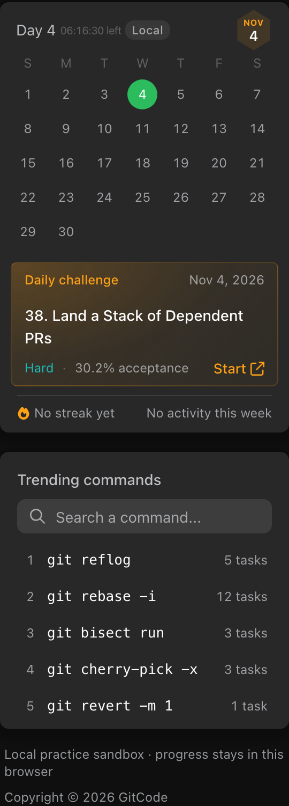</td>
    <td width="68%" valign="top">
      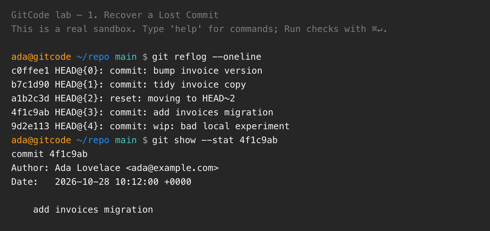
      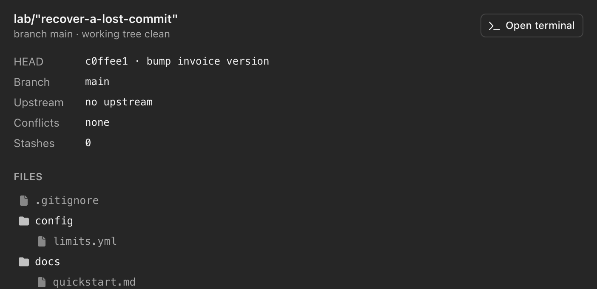
    </td>
  </tr>
  <tr>
    <td align="center"><sub>270 px rail · calendar · daily · trending</sub></td>
    <td align="center"><sub>Live terminal + workspace · real repo state and file status</sub></td>
  </tr>
</table>

---

## Every width

<table>
  <tr>
    <td width="50%" align="center">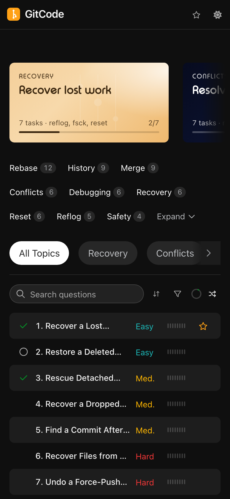</td>
    <td width="50%" align="center">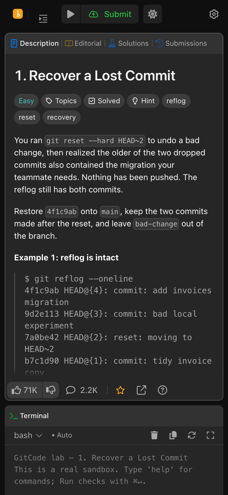</td>
  </tr>
  <tr>
    <td align="center"><sub><b>Dashboard</b> · 390 px</sub></td>
    <td align="center"><sub><b>Question</b> · 390 px</sub></td>
  </tr>
</table>

<p align="center"><sub>Verified at 320 / 480 / 768 / 1024 / 1440 px · zero horizontal overflow · zero console errors</sub></p>

---

## Run it

```bash
python3 -m http.server 8000
```

Open <http://127.0.0.1:8000> — or use the **[live demo](https://abhinav-prabhakar.github.io/GitCode/)**.
The pages also work from `file://`; the scripts are classic `<script>` tags, not ES modules.

---

## How it's built

- **Two static pages.** `index.html` is the problem set; `problem.html?p=<slug>` is the question.
- **LeetCode's own CSS.** The compiled stylesheets in `assets/css/vendor/` are vendored untouched,
  and copied components keep their original class names. Only pieces LeetCode has no
  equivalent for are authored as `gc-*` in `assets/css/app.css`.
- **No framework, no build.** Vanilla JS, local data, TypoRound vendored for offline rendering.
- **A real Git engine in the page.** `git-engine.js` models commits, trees, refs, reflog, conflicts,
  merges, rebases, remotes and history rewrites. Commands mutate actual state, not a transcript.
- **State-based checks.** `labs.js` seeds 44 reproducible repositories and tests outcomes — ancestry,
  trees, refs, reflog, ignore rules — instead of matching typed strings.
- **Local progress.** `progress.js` stores status, attempt counts and submission history in
  `localStorage`; the dashboard recomputes every track from it.

The full design contract — palette, dimensions, component anatomy, responsive rules — lives in
**[`design.md`](./design.md)**.

## Lab audit

The labs are checked in Node without a browser:

```bash
npm test              # audit every lab
npm run audit:labs    # same harness, verbose
```

The harness loads `data.js`, `git-engine.js`, and `labs.js` in a VM, seeds all 44 repositories, runs
each official solution, and asserts that every check passes. It also asserts that every lab fails at
seed, that every hidden check is objective-specific, and that seeded shortcut solutions (stash-less
rebases, merge-instead-of-lease pushes, blob copies, bisect-without-good/bad, note-only answers) are
rejected. The same command runs in `.github/workflows/labs.yml`.

<details>
<summary><b>File map</b></summary>

```
index.html                  dashboard shell
problem.html                question-page shell
design.md                   design-system contract

assets/
  css/vendor/               LeetCode CSS, byte-for-byte (do not edit)
  css/app.css               tokens + authored gc-* components
  fonts/                    TypoRound (rounded display face for track cards)
  js/icons.js               icon geometry + icon()
  js/data.js                44 tasks, categories, tracks, daily/trending
  js/ui.js                  nav, theme, menus, modals, tabs, splitters
  js/dashboard.js           filtering, search, bookmarks, rail, live progress
  js/problem.js             terminal, editor, rebase plan, checks, submissions
  js/git-engine.js          deterministic Git objects, refs and commands
  js/labs.js                44 seeded labs, checks, solutions, resolutions
  js/progress.js            localStorage status, attempts and submissions

tools/
  audit-labs.js             seed/solution/check harness
  fixtures/                 alternate and shortcut solutions

progress.md                 audit findings and fix status
docs/screenshots/           every image above
_reference/                 capture manifest + collector
```

</details>

<details>
<summary><b>What is local by design</b></summary>

No backend, no authentication, no network calls. The Git engine, 44 labs, checks, editor and
submissions all run in the page. Theme, bookmarks and progress persist in `localStorage`; the
repository itself reseeds on reload. There is no real remote — `fetch`, `push` and `pull` operate
on the in-memory remotes defined by each lab.

</details>

---

<p align="center">
  <sub>Git-themed content on a faithful LeetCode shell. Not affiliated with LeetCode.</sub>
</p>
